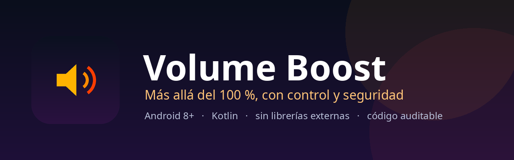

<p align="center">
  
</p>

<p align="center">
  <a href="https://github.com/JonathanDevHurtado/VolumeBoost/actions/workflows/android.yml"></a>
  
  
  
  <a href="https://github.com/JonathanDevHurtado/VolumeBoost/releases/latest"></a>
  
</p>

# Volume Boost

**Sube el volumen de tu Android del 100 % (el máximo del sistema) hasta el 150 %, con un medidor
claro, avisos sonoros y un modo compatible para los teléfonos que ignoran los efectos globales.**

Hecho para el **Xiaomi Redmi Note 13 Pro 4G (Helio G99 Ultra)** y compatible con **Android 8.0
(API 26) o superior**. Sin anuncios, sin cuentas, sin telemetría y sin conexión a Internet.

> **Código auditable, producto propietario.** Este repositorio se publica para que cualquiera pueda
> revisar la seguridad y el funcionamiento del código. **No es open source**: consulta
> [`LICENSE`](LICENSE) antes de reutilizarlo.

---

## Descarga

[](https://github.com/JonathanDevHurtado/VolumeBoost/releases/latest)

| Archivo | Uso |
|---|---|
| `VolumeBoost-1.2.0.apk` | Instalar en el teléfono (firmado, listo para usar) |
| `VolumeBoost-1.2.0.aab` | Subir a Google Play |
| `VolumeBoost-1.2.0-docs.zip` | Documentación completa sin conexión |
| `SHA256SUMS.txt` | Verificar la integridad de las descargas |

```bash
sha256sum -c SHA256SUMS.txt
```

> Requiere **Android 8.0 (API 26)** o superior. El APK está firmado con una clave
> de release; no es un build de depuración.

---

## Índice

- [Descarga](#descarga)
- [Qué hace](#qué-hace)
- [Estado de verificación](#estado-de-verificación)
- [Cómo funciona](#cómo-funciona)
- [Compilar e instalar](#compilar-e-instalar)
- [Estructura del proyecto](#estructura-del-proyecto)
- [Documentación](#documentación)
- [Dificultades reales del proyecto](#dificultades-reales-del-proyecto)
- [Privacidad y permisos](#privacidad-y-permisos)
- [Seguridad](#seguridad)
- [Contribuir](#contribuir)
- [Licencia](#licencia)
- [Autor](#autor)

---

## Qué hace

- **Medidor circular de 100 % a 150 %** con degradado verde → amarillo → naranja → rojo.
- **Pasos de 5 %** con botones `−` y `+`, y atajos **100 / 110 / 125 / 150 %**.
- **Botones de mantener presionado** (`Subir` / `Bajar`, con iconos de flecha): la aguja avanza de forma fluida a
  unos 10 puntos por segundo.
- **Avisos sonoros generados por código** (sin archivos de audio): un clic cada 5 %, un bip al
  soltar y una campanita de tres notas al llegar al 150 %.
- **Servicio en primer plano** para que el refuerzo siga activo con la pantalla apagada, con
  notificación y acción **«Volver a 100 %»**.
- **Sonido de prueba integrado** para comprobar el efecto sin depender de otra app.
- **Aviso de volumen del sistema**: recuerda que el 100 % de la app solo equivale al máximo real del
  teléfono si el volumen multimedia está al máximo.
- **Modo compatible por app** para fabricantes que ignoran los efectos sobre la mezcla global.

### Captura del icono

<p align="center">
  
</p>

No se incluyen capturas de pantalla inventadas. Las capturas reales se añadirán cuando se validen
en un dispositivo físico; el checklist está en [`docs/VERIFICACION.md`](docs/VERIFICACION.md).

---

## Estado de verificación

| Comprobación | Resultado |
|---|---|
| Compilación `assembleDebug` | Correcta |
| Pruebas unitarias `testDebugUnitTest` | 17 pruebas correctas |
| Lint `lintDebug` | 0 errores, 4 avisos |
| Entorno | JDK 17.0.13 · Gradle 8.10.2 · AGP 8.7.3 · SDK 35 |
| Prueba en Nokia 5.4 (Android 12) | Arranque, medidor, efecto global, servicio y apagado verificados |
| Prueba en Redmi Note 13 Pro | Pendiente (ver checklist) |

La app se compiló y se probó a nivel de JVM y en un **Nokia 5.4 con Android 12**: arranque,
medidor, efecto global, servicio en primer plano y apagado automático. **No se afirma** que se
haya probado en un Redmi Note 13 Pro real: eso requiere un dispositivo y está documentado como
trabajo pendiente, no como algo ya validado.

---

## Cómo funciona

Android **no permite** a una app subir el volumen del sistema por encima de su máximo. Lo que sí
permite es **amplificar la señal digital** con `android.media.audiofx.LoudnessEnhancer`:

| Medidor | Amplitud | Ganancia |
|---:|---:|---:|
| 100 % | ×1,00 | 0 mB |
| 125 % | ×1,25 | 194 mB (+1,9 dB) |
| 150 % | ×1,50 | 352 mB (+3,5 dB) |

La fórmula es `mB = 2000 · log10(porcentaje / 100)` y vive en `BoostMath`, con pruebas unitarias.

Hay dos modos:

1. **Global (por defecto):** un `LoudnessEnhancer` sobre la sesión de audio 0 (la mezcla de salida).
   Afecta a todo el audio del teléfono.
2. **Compatible por app:** escucha las sesiones que anuncian los reproductores
   (`ACTION_OPEN_AUDIO_EFFECT_CONTROL_SESSION`) y engancha un efecto a cada una. Es la salida para
   equipos que ignoran la sesión 0.

**Nunca se aplican ambos modos al mismo audio**, para no multiplicar la ganancia. Si el efecto
global falla, el motor cae automáticamente al modo por app.

> **Límite honesto:** el refuerzo digital puede distorsionar audio que ya está cerca de 0 dBFS y,
> con audífonos, puede ser peligroso. Empieza bajito. La app muestra un aviso la primera vez.

Más detalle: [`docs/FUNCIONAMIENTO.md`](docs/FUNCIONAMIENTO.md) y
[`docs/ARQUITECTURA.md`](docs/ARQUITECTURA.md).

---

## Compilar e instalar

### Requisitos

- **JDK 17** (recomendado) o JDK 21. **No uses JDK 25/26**: Gradle 8.10 no los soporta.
- **Android SDK 35** y **Build Tools 35.0.0**.
- Android Studio Ladybug o superior (opcional; también funciona por línea de comandos).
- Linux, macOS o Windows.

### Línea de comandos

```bash
git clone https://github.com/JonathanDevHurtado/VolumeBoost.git
cd VolumeBoost

# SDK: crea local.properties con la ruta de tu SDK
echo "sdk.dir=$HOME/Android/Sdk" > local.properties

# Compilar + pruebas
./gradlew assembleDebug testDebugUnitTest

# Instalar en el teléfono conectado por USB
adb install -r app/build/outputs/apk/debug/app-debug.apk
```

### Scripts para Fedora

El proyecto incluye scripts pensados para Fedora 44, donde el JDK del sistema puede ser demasiado
nuevo:

```bash
./scripts/instalar-sdk-fedora.sh      # JDK 21 portable + Android SDK (una sola vez)
./scripts/compilar.sh --test          # compila, prueba y deja dist/VolumeBoost-debug.apk
./scripts/instalar-en-telefono.sh     # instala por USB
```

Guía completa: [`docs/COMPILAR_FEDORA44.md`](docs/COMPILAR_FEDORA44.md).

### Firma de release

Crea `keystore.properties` en la raíz (está ignorado por Git) con:

```properties
storeFile=/ruta/a/tu-keystore.jks
storePassword=...
keyAlias=...
keyPassword=...
```

Si el archivo no existe, el APK de release se genera **sin firmar**. Nunca subas el keystore ni las
contraseñas al repositorio.

---

## Estructura del proyecto

```text
VolumeBoost/
├── app/src/main/java/com/volumeboost/app/
│   ├── MainActivity.kt      # pantalla, gestos de mantener, permisos y avisos
│   ├── BoostEngine.kt       # LoudnessEnhancer global y por sesión
│   ├── BoostService.kt      # servicio en primer plano y notificación
│   ├── BoostMath.kt         # matemática pura (dB, pasos, frecuencias)
│   ├── GaugeView.kt         # medidor circular dibujado a mano
│   ├── Sfx.kt               # tonos de aviso sintetizados
│   └── TestTone.kt          # sonido de prueba en bucle
├── app/src/test/            # pruebas JVM (matemática y síntesis)
├── docs/                    # arquitectura, decisiones, verificación, problemas
├── scripts/                 # instalación, compilación e instalación por USB
├── .github/                 # CI, plantillas de issues y PR
├── gradle/                  # wrapper 8.10.2
├── banner.png               # cabecera del repositorio
└── store/icon-512.png       # icono para ficha de tienda
```

**Paquete:** `com.volumeboost.app` · **minSdk:** 26 · **targetSdk:** 35 · **sin dependencias de UI.**

---

## Documentación

| Documento | Contenido |
|---|---|
| [`docs/ARQUITECTURA.md`](docs/ARQUITECTURA.md) | Capas, estado, hilos, ciclo de vida del servicio |
| [`docs/DECISIONES.md`](docs/DECISIONES.md) | ADRs: por qué LoudnessEnhancer, por qué sin AndroidX, etc. |
| [`docs/DIFICULTADES.md`](docs/DIFICULTADES.md) | Problemas reales encontrados y cómo se resolvieron |
| [`docs/FUNCIONAMIENTO.md`](docs/FUNCIONAMIENTO.md) | Audio, ganancia, modos y límites físicos |
| [`docs/VERIFICACION.md`](docs/VERIFICACION.md) | Comandos, resultados y checklist en dispositivo |
| [`docs/PRIVACIDAD.md`](docs/PRIVACIDAD.md) | Qué datos usa (ninguno) y por qué |
| [`docs/SOLUCION_PROBLEMAS.md`](docs/SOLUCION_PROBLEMAS.md) | Fallos típicos al compilar y en HyperOS/MIUI |
| [`docs/COMPILAR_FEDORA44.md`](docs/COMPILAR_FEDORA44.md) | Guía paso a paso en Fedora |
| [`docs/PUBLICAR.md`](docs/PUBLICAR.md) | Firma, artefactos, checksums y publicación |

---

## Dificultades reales del proyecto

Las decisiones no salieron a la primera. Un resumen honesto de lo que costó:

- **Fedora 44 trae JDK 25/26** y Gradle 8.10 no arranca con ellos. Se añadió un JDK 21 portable y
  scripts que no tocan el Java del sistema.
- **Los efectos de audio globales están marcados como obsoletos** y algunos fabricantes los ignoran.
  Por eso existen dos modos y una caída automática, con mensajes claros en pantalla.
- **El audio por *offload* o con DRM** puede saltarse el efecto por completo. No es un bug que la
  app pueda arreglar; se documenta en lugar de prometer magia.
- **Android 14 exige un tipo de servicio en primer plano.** Se usa `specialUse` con subtipo
  declarado, y el servicio se arranca solo cuando la UI está visible.
- **Carreras al arrancar/parar el servicio**: al volver a 100 % se espera 2,5 s antes de detenerlo,
  para que pulsar `+` justo después no deje el proceso sin protección.
- **Fugas de `AudioTrack`** en los tonos: se liberan con retardo y hay un tope de pistas vivas.
- **Probar sin dispositivo**: se compensó con pruebas JVM de la matemática y de la síntesis PCM,
  además de un checklist manual explícito. No se fingió una validación que no existía.

El postmortem completo, con contexto y lecciones, está en
[`docs/DIFICULTADES.md`](docs/DIFICULTADES.md).

---

## Privacidad y permisos

Volume Boost **no tiene permiso de Internet** y **no recopila, transmite ni comparte datos**. No hay
analytics, anuncios, cuentas ni telemetría. `allowBackup=false` evita copias automáticas de sus
preferencias.

| Permiso | Para qué |
|---|---|
| `MODIFY_AUDIO_SETTINGS` | Crear el efecto `LoudnessEnhancer` |
| `FOREGROUND_SERVICE` + `FOREGROUND_SERVICE_SPECIAL_USE` | Mantener el refuerzo con la pantalla apagada |
| `POST_NOTIFICATIONS` (Android 13+) | Mostrar la notificación del servicio |

Detalle: [`docs/PRIVACIDAD.md`](docs/PRIVACIDAD.md).

---

## Seguridad

Si encuentras una vulnerabilidad, **no abras un issue público**. Escribe a
**JonathanHurtadoDev@proton.me** con pasos de reproducción, impacto y versión afectada. Consulta
[`SECURITY.md`](SECURITY.md) para el proceso y los plazos.

---

## Contribuir

Las contribuciones son bienvenidas siempre que respeten la licencia y el contrato de contribución.
Lee [`CONTRIBUTING.md`](CONTRIBUTING.md):

1. Abre un issue o una discusión antes de cambios grandes.
2. Crea una rama `feat/...`, `fix/...` o `docs/...`.
3. Añade pruebas para la lógica pura (`BoostMath`, `Sfx`).
4. Ejecuta `./gradlew testDebugUnitTest lintDebug`.
5. Abre un Pull Request con el contexto y la evidencia.

Al enviar una contribución aceptas los términos de la sección 4 de [`LICENSE`](LICENSE).

---

## Licencia

**Propietaria, source-available.** Copyright © 2026 Jonathan Hurtado. Todos los derechos
reservados.

El código se publica para **auditoría y revisión**. No puedes usarlo en producción, modificarlo,
redistribuirlo, venderlo ni incluirlo en otro producto sin un acuerdo escrito. **No es open source.**
Lee el texto completo en [`LICENSE`](LICENSE).

Para licencias comerciales: **JonathanHurtadoDev@proton.me**.

---

## Autor

**Jonathan Hurtado** — *Autor y mantenedor*

- GitHub: [@JonathanDevHurtado](https://github.com/JonathanDevHurtado)
- Correo: [JonathanHurtadoDev@proton.me](mailto:JonathanHurtadoDev@proton.me)

<p align="center">
  Hecho con cuidado, Kotlin y muy pocas dependencias.
</p>
